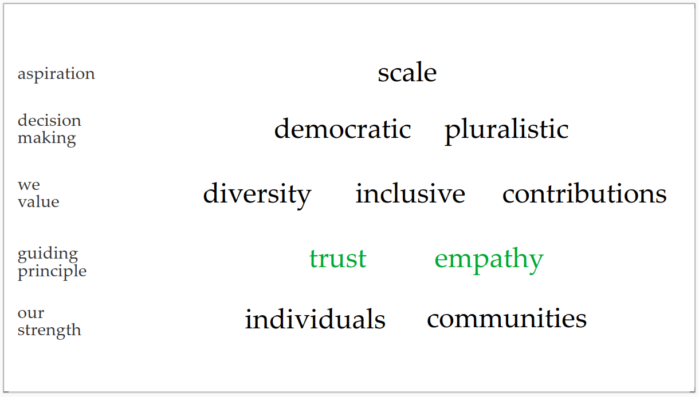

# Code of Conduct

STATE: **DRAFT**

Every member signing up knows that their contributions keep the
community ticking. Contributions can be monetary or time - with
time being the most precious!

Members agree to be respectful and considerate in their interactions.

The core values of the community can be visualized as below:

Members agree to be fair to all concerned. Not just their own
causes, or of those surrounding them. This responsibility is
greatly amplified during voting.  All voters are required to
carefully review projects and cast their votes.

Popularity contests aren't the way to achieve common goals such as
growing our community, or generate usable outputs. Thus, we specifically
expect everyone to carefully review at-least 20-30% of the projects up for
voting before casting their votes.

# Authors

Shree Kumar

# License

CC-BY-SA-4.0
